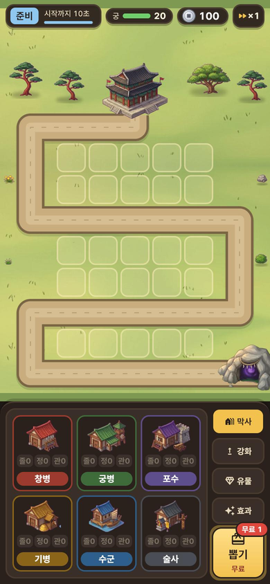
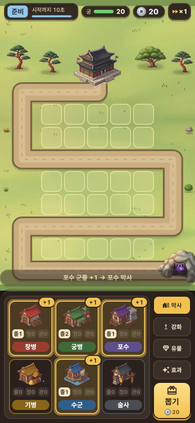
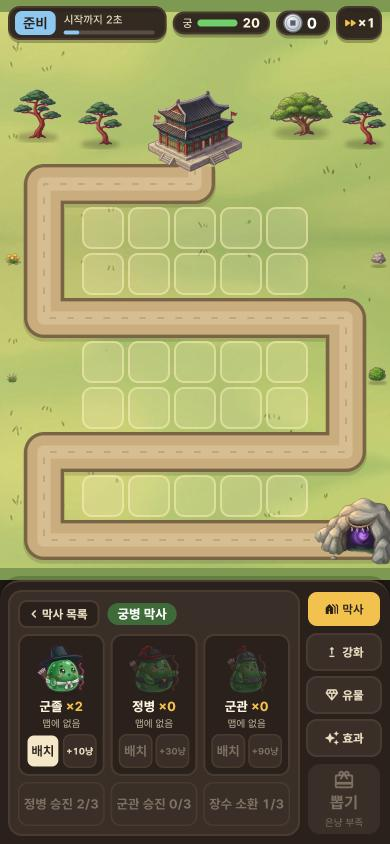
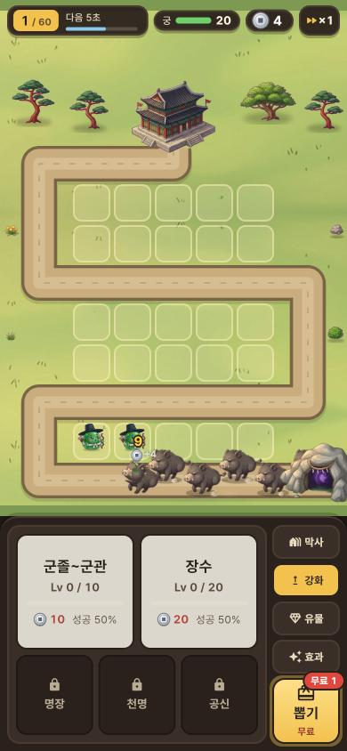
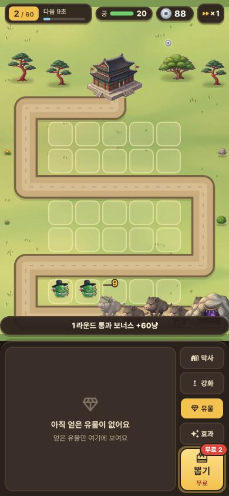

# 세로 화면(C안) 그래픽 리소스 작업 지시서

> **새 세션에서 쓰는 법:** 이 문서와 `art/docs/progress.md`를 함께 붙여 넣고 **"세로 화면 리소스 1번부터 진행"**이라고 하면 됩니다.
> 저장소: `mallang-heroes/mallang-heroes.github.io` (브랜치 + PR로 올리고, `main`에 합치면 Pages에 자동 배포).

게임 화면은 2026-10-27에 가로형(둥근 순환로 + 오른쪽 패널)에서 **세로형 C안**으로 바뀌었고, 코드는 이미 `main`에 들어가 있습니다(PR #12·#13·#14).
지금 화면의 길·배치 칸·패널·버튼·아이콘은 **임시로 코드와 Material 아이콘으로 그린 것**이라, 이 문서의 리소스를 만들어 바꿔 끼우는 것이 다음 작업입니다.
그림체는 기존과 같은 **B (2단 셀 셰이딩, 외곽선 #2A211C, 광원 왼쪽 위)**를 유지합니다.

---

## 1. 확정된 화면 (C안)

| 지금 화면 | |
|---|---|
|  | 준비 라운드 · 막사 목록 · 뽑기 무료권 |
|  | 뽑은 유닛이 막사 카드에 +1로 들어감 |
|  | 막사 안: 등급별 배치·판매, 승진·장수 소환 |
|  | 강화 탭 · 1층 칸에 배치한 유닛이 전투 중 |
|  | 유물 탭(빈 안내) · 라운드 통과 보너스 알림 |

영역과 치수: [`art/preview/portrait/zones.png`](../preview/portrait/zones.png) (스크립트 `art/tools/map/make_portrait_guide.py`)

디자인 검토용 캔버스(가로 A·B·B2안, 세로 A·B·C안 목업 비교, 소유자만 열람): https://claude.ai/artifact/WEpEEnM1YsmG5mTBA5jsSf — 게임에 들어간 최종안은 위 캡처가 기준입니다.

### 구성
- **세로 폰 390×844pt 기준.** 위쪽 약 580pt는 맵(Flame), 아래 약 264pt는 트레이(Flutter). PC 등 넓은 화면은 가운데에 폰 비율로 보여 줌.
- **정보줄**(맵 위에 겹침, 높이 34pt): 라운드 or "준비" · 남은 시간 막대 / 궁 체력 막대(20) / 은냥 / 속도 ×1·×2.
- **맵**: 오른쪽 아래 **동굴** → 왼쪽으로 → 위로 꺾이며 **3층 구불길** → 맨 위 가운데 **궁**. 몬스터가 궁에 닿으면 궁 체력 −1, 보스가 닿으면 즉시 패배.
- **배치 칸 25개**: 1층(동굴 바로 앞) 1×5 "정예 줄", 2층 2×5, 3층 2×5. 유닛은 칸 위에만 서고, 다른 유닛 칸에 놓으면 자리를 바꿈.
- **트레이**: 왼쪽 내용(296×246pt) + 오른쪽 세로 탭 4개(막사·강화·유물·효과, 각 76×38pt) + 맨 아래 **뽑기** 버튼(76×74pt).
  - 막사 목록: 병과 6개 카드(3×2). 카드 = 막사 그림 + 등급 칩 "졸n 정n 관n" + 병과 이름표. 유닛이 들어오면 금색 테두리 + "+1".
  - 막사 안: 군졸·정병·군관 카드(움직이는 슬라임, ×수량, 맵에 n명, [배치] [+판매가]) + [정병 승진 n/3] [군관 승진 n/3] [장수 소환 n/3].
  - 강화: 군졸~군관 · 장수(큰 버튼), 명장 · 천명 · 공신(잠김).
  - 유물: 가진 유물만 목록으로(지금은 빈 안내). 효과: 가진 유물 효과를 항목별로 합산(지금은 빈 안내).
  - 뽑기: 무료권이 있으면 빨간 "무료 n" 배지 + 금빛 테두리, 없으면 엽전 20, 은냥이 모자라면 회색 "은냥 부족".
- 맵 위에 없어진 것: 막사 건물 6채(트레이 카드로 이동), 집결지 깃발, 보급병.

### 수치 (코드 기준 — `lib/game/board.dart`의 `MapData`)
- **보드 585×834** (폰 390×556pt의 1.5배, 보드 1px = 0.667pt). 이미지 파일은 기존처럼 **@2x**(보드의 2배 픽셀).
- 길 중심선(보드 좌표): (560,792) → (66,792) → (66,660) → (519,660) → (519,459) → (66,459) → (66,258) → (292.5,258) → (292.5,232). 오른쪽 끝은 동굴 뒤 화면 밖까지 이어짐. **길 폭 60**(흙 50 + 테두리). 길이 약 2,180.
- 동굴 그림 바닥 가운데 (540, 800). 궁 그림 바닥 가운데 (292.5, 240), 궁 그림 약 141×122.
- 배치 칸: 63×63(모서리 15), 간격 69. 열 x = 154.5 · 223.5 · 292.5 · 361.5 · 430.5 / 행 y = 726(1층) · 594 · 525(2층) · 393 · 324(3층). 유닛 발은 칸 가운데보다 14 아래.
- 장식 자리(나무·돌·덤불·꽃): `MapData.decorations` — 궁 양옆 나무 4그루와 가장자리 소품 4개.
- 유닛 판정 72×84, 몬스터 그림 배율 일반 1.8 · 보스 1.6 (`Rules.mobScale`, `bossScale`).

---

## 2. 만들 리소스 (우선순위 순)

> 크기는 **@2x 픽셀**. 게임 에셋은 WebP(만든 뒤 `python3 art/tools/web/to_webp.py`), 원본·미리보기는 PNG.
> 연결(코드 수정)까지 같은 PR에서 해 주세요. 각 항목에 바꿀 코드 위치를 적어 두었습니다.

| # | 리소스 | 파일 (assets/images/…) | 크기 @2x | 지금 상태 | 연결할 곳 |
|---|---|---|---|---|---|
| 1 | **세로 맵 배경** (풀밭 + 구불길 + 궁 마당, 길이 그림에 포함) | `map/map-portrait-bg.webp` | 1170×1668 | 풀밭은 가로 배경을 잘라 이어 붙인 `map-grass.webp`, 길은 코드로 그린 띠 | `lib/game/map_layer.dart` `MapLayer.onLoad`: 배경을 이 파일로 바꾸고 `_drawRoad` 호출 삭제 |
| 2 | **배치 칸** (빈 칸 / 놓을 수 있음 / 놓을 수 없음) | `map/map-tile.webp`, `map-tile-ok.webp`, `map-tile-bad.webp` | 126×126 | 코드로 그린 반투명 둥근 사각형 | `MapLayer._drawTiles`(빈 칸), `units.dart` `FieldUnit.render` 끄는 중 그림자 |
| 3 | **UI 스킨** — 패널·버튼 9-slice | `ui/panel-dark.webp`(먹색 옻칠 판 + 금테), `ui/button-paper.webp`(한지 버튼), `ui/button-gold.webp`(금색 버튼), `ui/button-dark.webp`(잠김·꺼짐) | 각 96×96, 9-slice 여백 24px | `overlays.dart`의 `_panelBox`·`BoxDecoration` 단색 | `overlays.dart` — `DecorationImage(centerSlice: Rect.fromLTRB(24,24,72,72))`로 교체 |
| 4 | **UI 아이콘** (@3x 단독 PNG→WebP, 투명) | `ui/icon-barracks`, `icon-upgrade`, `icon-relic`, `icon-effect`, `icon-draw`(복주머니), `icon-speed`, `icon-lock`, `icon-palace`(궁 체력 앞), `icon-up`(승진 가능 표시), `icon-back` | 각 72×72 (24pt @3x) | Material 아이콘 (`Icons.holiday_village_rounded` 등) | `overlays.dart` `Tray._side`, `_DrawButton`, `StatusBar`, `_UpgradePanel`, `_BarracksCard`, `_BarracksInside` |
| 5 | **몬스터 고해상도 다시 내보내기** (새 그림 불필요) | `monsters/*` 시트 | 일반 프레임 = 기존 × 1.8, 보스 × 1.6 | 기존 @2x 시트를 1.8배로 늘려 그려서 폰에서 흐림 | `art/tools/monster/build_monsters.py`에 배율 인자를 넣어 다시 출력 → `Rules.mobScale`·`bossScale`을 1.0으로, `meta.body`도 같은 배율로 |
| 6 | **궁 피해 상태** (금 간 기와·연기) | `map/map-bld-palace-hurt1.webp`(체력 50% 이하), `-hurt2.webp`(25% 이하) | 기존 궁과 같은 캔버스 283×244 | 피해 표시 없음(들썩임만) | `map_layer.dart` `Palace.render`에서 `game.palaceHp`로 고르기 |
| 7 | **막사 카드 그림** (선택) | `ui/card-barracks-<병과>.webp` | 168×140 | 맵용 막사 그림을 그대로 줄여 씀 | `_BarracksCard`의 `Image.asset` 경로. **포수 막사 창 거치대 문제**를 이때 같이 고침 |
| 8 | **로딩 화면 세로판** | `web/loader-bg-portrait.jpg` | 1170×2532 | 가로 배경 그대로라 세로에서 작게 보임 | `web/index.html`의 `#ml-stage`(1560×720 기준)를 390×844 기준으로, `art/tools/web/make_loader.py` |
| 9 | 유물 아이콘 | `ui/relic-<id>.webp` | 96×96 | 유물 시스템 미정 | 유물 종류가 정해진 뒤 |

**그대로 쓰는 것:** 슬라임 유닛 24종(맵·막사 안), 궁(`map-bld-palace` + 들썩임), 동굴(`map-spawn-cave` 4프레임), 장식 13종, 엽전(코드), 이펙트.
**안 쓰게 된 것:** `map/map-bg.webp`(가로 배경), `map-bld-barracks-*-enter`(들썩임), `assets/data/map-path.json`(가로 경로). 지우지는 않았습니다.

### UI 색 (지금 코드 값 — 스킨을 이 톤에 맞춰 주세요)
| 이름 | 값 | 쓰임 |
|---|---|---|
| 먹 | `#2A211C` | 외곽선, 트레이 바탕, 진한 글자 |
| 패널 | `#2A211C` 92% + 테두리 `#4A3B30` | 정보줄, 알림, 상세 창 |
| 카드 | `#3A2F28` | 트레이 안쪽 칸, 꺼진 버튼 |
| 크림 / 보조 / 흐림 | `#FFF6E0` / `#E9DCC0` / `#B9AC95` | 글자 |
| 금 / 진금 | `#F2C14E` / `#B8891E` | 선택된 탭, 뽑기, 강조 테두리 |
| 한지 버튼 | `#F5E8C8` (아랫그늘 `#D9C59A`) | 배치·강화·승진 버튼 |
| 빨강 / 하늘 / 초록 | `#E0483E` / `#8EC7F0` / `#6FCF6A` | 무료 배지·위험 / 준비·시간 / 궁 체력 |
| 병과 | 창병 `#9A3B2E` · 궁병 `#3F6B3A` · 포수 `#5E4E8C` · 기병 `#8A6418` · 수군 `#2E5E8C` · 술사 `#4A4E54` | 카드 테두리, 이름표 |

글꼴: 게임은 Pretendard(본문)·고운바탕(제목). 캔버스 목업에서 쓴 둥근 글꼴(Jua)은 아직 넣지 않았음 — 넣을지 정해 주세요.

---

## 3. 제미나이 프롬프트

> 기존 규칙과 같습니다: **영어 블록만** 복사, 스프라이트는 **단색 마젠타(#FF00FF) 배경**, 모두 **같은 대화창**에서 뽑고 앞 결과를 첨부해 그림체를 맞춤.

### ① 세로 맵 배경 — 첨부: `art/source/gemini/map-portrait/map-portrait-layout-guide.png` (+ 기존 `art/source/gemini/map/map-bg.png`를 그림체 참고로)

```
Generate an image. Do not write any words, letters or numbers anywhere in the image.

Repaint the first attached layout image as a finished background for a cute vertical (portrait) mobile tower-defense game, in exactly the same art style, lighting and colors as the second attached image.
Keep the composition EXACTLY the same: same image size and portrait aspect ratio, the dirt road in exactly the same position, width and zigzag shape (it enters from the right edge at the bottom, runs left, turns up, runs right, turns up, runs left, turns up and ends at the small stone plaza near the top center), the dark cave spot at the bottom right, and the light stone plaza near the top center. Do not move, bend, widen or narrow the road.

Style: cute casual mobile game art, soft painted shading, light from the top-left, clean but soft outlines, warm and bright colors, seen from slightly above.
Ground: soft green grass with gentle color variation and a few tiny grass blades. Keep the large flat grass areas between the road segments calm and low-detail, because square unit slots will be drawn on top of them.
Road: packed light-brown dirt path with darker brown edges, faint wheel ruts and a few tiny pebbles.
Stone plaza: a small paved courtyard of light grey flagstones where a palace will be placed later. Do not draw the palace.
Cave spot: leave it as plain dark ground; the cave is a separate sprite.
Do NOT add trees, rocks, flowers, buildings, characters, fences, water or any other objects. Only grass, the road and the stone plaza.
No text, no UI, no frame, no vignette.
```

**확인할 것:** 길이 가이드와 겹치는지(어긋나면 Claude가 `make_portrait_guide.py`로 겹쳐 보고 맞춤), 칸이 들어갈 풀밭이 차분한지.

### ② 배치 칸 — 첨부: ① 결과

```
Generate an image. Do not write any words, letters or numbers anywhere in the image.

In exactly the same art style and colors as the attached map, draw three separate square tile sprites for unit placement slots, seen from straight above, each a rounded square with soft corners, on one solid flat magenta background (#FF00FF) with clear space between them.
1. Empty slot: a slightly raised square of pale trodden grass with a thin cream-colored stitched border, very subtle, so the grass still shows through.
2. Available slot: the same square with a brighter warm golden glowing border.
3. Blocked slot: the same square with a soft red border.
All three exactly the same size and shape. No characters, no shadows on the background, no text.
```

### ③ UI 스킨 시트 — 첨부: ① 결과 + 지금 화면 캡처 `art/preview/portrait/01-prep-barracks.png`

```
Generate an image. Do not write any words, letters or numbers anywhere in the image.

For the same cute Korean Joseon-themed mobile game as the attached images, draw a sheet of separate user-interface pieces on one solid flat magenta background (#FF00FF), with clear empty space between them. Flat front view, same soft cel-shaded style, dark brown outline #2A211C.

Panels and buttons (each a plain rounded rectangle with NO icon and NO text inside, so they can be stretched):
1. A dark lacquered wood panel, very dark brown, with a thin gold trim line inside the edge and small gold corner ornaments.
2. A cream hanji-paper button with a slightly darker bottom edge so it looks pressable.
3. A golden button, warm yellow-gold with a lighter top, darker bottom edge.
4. A disabled dark button, dull brown-grey, flat.

Icons (each about the same size, simple and readable at small size, no text):
5. A small Korean barracks building with a tiled roof.
6. An upward arrow on a small stone block (upgrade).
7. A green jade magatama-like gem (relic).
8. A sparkle burst of three stars (effect).
9. A red Korean silk lucky pouch (bokjumeoni) tied with a gold cord (draw).
10. Two right-pointing triangles (fast forward).
11. A small gold padlock.
12. A tiny palace roof (palace health).
13. A small round gold badge with an upward arrow (promotion ready).
14. A left-pointing chevron (back).
```

**확인할 것:** 패널·버튼 안에 무늬가 가운데까지 있으면 늘렸을 때 깨지므로, 무늬는 테두리 쪽에만 있게.

### ④ 궁 피해 상태 — 첨부: `art/source/gemini/map/map-buildings.png`(지금 궁)

```
Generate an image. Do not write any words, letters or numbers anywhere in the image.

Using the attached image, redraw ONLY the large royal palace, exactly the same size, angle, colors and outline, twice side by side on one solid flat magenta background (#FF00FF):
1. Lightly damaged: a few cracked and missing roof tiles, one small crack in the stone platform, a thin wisp of grey smoke.
2. Heavily damaged: many broken roof tiles, one torn red flag, scorch marks on a pillar, more grey smoke.
Keep it cute and not scary. No fire, no characters, no text.
```

---

## 4. 작업 흐름
1. ①~④를 제미나이에서 뽑아 `art/source/gemini/map-portrait/`(맵·칸·궁 피해), `art/source/gemini/ui/`(UI)에 저장.
2. 추출·정리 스크립트는 기존 `art/tools/map/build_map.py`, `art/tools/rig/extract.py`의 마젠타 배경 제거·워터마크 지우기를 그대로 활용. 맵 배경은 가이드와 겹쳐 확인(`art/preview/portrait/`에 겹침 미리보기 저장).
3. 결과를 `assets/images/map/`, `assets/images/ui/`에 넣고 `pubspec.yaml`의 `flutter.assets`에 `assets/images/ui/` 추가 → `to_webp.py`.
4. 2절 표의 "연결할 곳"을 고치고, 폰 390×844로 띄워 캡처를 `art/preview/portrait/`에 갱신.
5. `art/docs/progress.md`의 10단계 표를 갱신하고 PR.

## 5. 아직 정하지 않은 것 (작업 중 막히면 사용자에게 물어볼 것)
- UI 글꼴을 둥근 글꼴(Jua 등)로 바꿀지.
- 유물 종류·아이콘(9번은 그 뒤).
- 몬스터 속도·체력·사거리 밸런스(세로 맵 기준으로 다시 맞출 예정 — 그래픽 작업과 별개).
